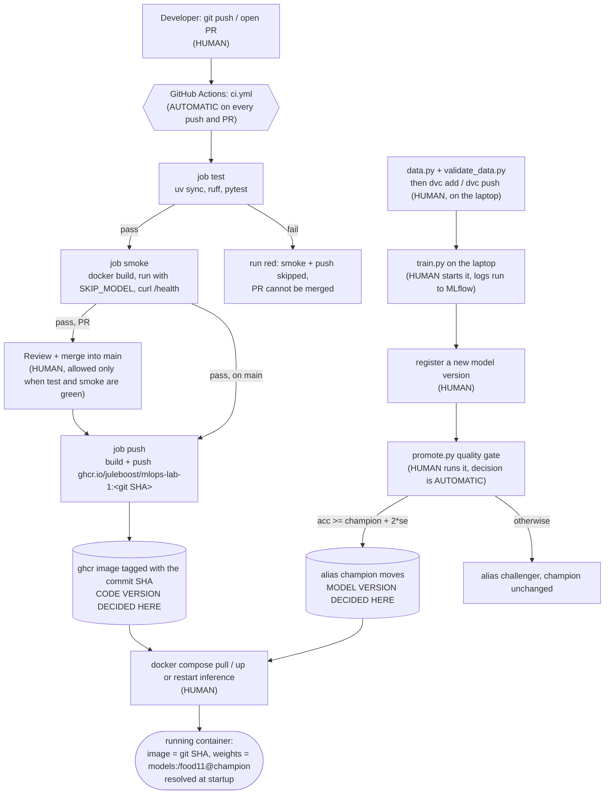

# Lab 5 - Pipeline from git push to a running container

Automatic: everything inside GitHub Actions (lint, tests, image build, smoke test, push to ghcr on
main) and the promote/reject decision itself.

Still human: pushing and merging code, preparing data and running `dvc push`, training,
registering a version, running `promote.py`, and starting or restarting the container.

The code version is fixed by the git commit SHA, which is also the image tag. The model version
is fixed separately by the `champion` alias in the MLflow registry, read when the container starts.
